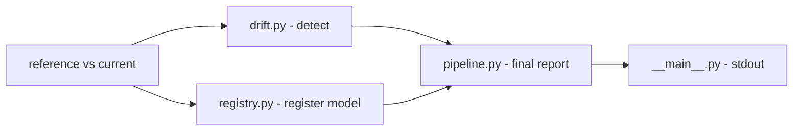

# mlops-registro-drift

**English** · [Português (Brasil)](README.md)

[](#) [](#) [](#) [](#) [](#) [](LICENSE)

## What it is

**An MLOps pipeline for model registration and data-drift detection**: it registers a model (via **MLflow** when installed, otherwise in a **local JSON**) and compares **reference vs current** data to detect **drift** (via **Evidently** when installed, otherwise with its own statistical test on column means). It includes a **Dockerfile** to run the pipeline in isolation. It is an educational MLOps lab that is robust to the environment (fallbacks).

## Status

An educational MLOps lab, working and tested (19 tests). Runs without the optional dependencies (built-in fallbacks).

## Features

- **Model registration** (`registry.py`): `ModelEntry`/`ModelRegistry` with versioning; uses MLflow if available, otherwise writes to a local JSON (`source: "local"/"mlflow"`).
- **Drift detection** (`drift.py`): `DriftDetector`/`DriftReport` — compares column means (Evidently if available); reports `drift_detected`, `n_drifted`, `n_columns`.
- **Pipeline** (`pipeline.py`): orchestrates registration + drift end to end.
- **Dockerfile**: `python:3.12-slim`, installs `.[dev]`, runs `python -m mlops_registro_drift`.
- **Fallbacks**: optional dependencies (MLflow/Evidently) have a built-in fallback path.

## Architecture

A `mlops_registro_drift` package with `registry.py` (model + version), `drift.py` (detection) and `pipeline.py` (orchestration). `__main__.py` runs on synthetic data and prints the result.



## Stack

- Python ≥ 3.10 (stdlib base; mlflow/evidently optional in extras)
- Docker (python:3.12-slim)
- pytest (dev)

## Repository layout

```
mlops-registro-drift/
├── pyproject.toml · BRIEF.md · Dockerfile
├── src/mlops_registro_drift/
│   ├── registry.py     # model registration/versioning
│   ├── drift.py        # data-drift detection
│   ├── pipeline.py     # orchestration
│   └── __main__.py     # CLI/synthetic-data demo
├── tests/              # 19 tests
└── LICENSE             # MIT
```

## Prerequisites and installation

Python ≥ 3.10.

```bash
pip install -e .          # base (fallbacks)
pip install -e ".[mlflow,evidently]"   # optional: real integrations
```

## How to run

```bash
python -m mlops_registro_drift
# Pipeline mlops-registro-drift executado com sucesso.
# Modelo: modelo-demo v2 (local)
# Drift detectado: False (0/2 colunas)

# via Docker
docker build -t mlops-drift . && docker run --rm mlops-drift
```

## Tests and quality

Real command (verified by the agent):

```bash
PYTHONPATH=src python -m pytest tests/
# 19 passed
```

## Technical decisions and trade-offs

- **Fallbacks (MLflow/Evidently optional)**: the pipeline runs in any environment; in exchange, without the integrations it uses its own implementations.
- **Local JSON registration** when MLflow is absent: simple and portable versioning.
- **Drift on column means**: a light and transparent statistical test; less powerful than full Evidently.

## Known limitations and roadmap

- Without MLflow/Evidently installed, it uses the fallbacks (functional, but less robust than the tools).
- Drift detects basic distribution shifts (means); it does not cover correlations/advanced data quality.
- Demo with synthetic data in `__main__`.

## Development process

An individual project by Kelvin Oliveira, built with orchestrated AI agents and reviewed by the author. The MLOps pipeline, the fallbacks and the review are the author's.

## License and author

MIT — Copyright (c) 2026 Kelvin Rebelo de Oliveira.

**Author**: [Kelvin Oliveira](https://github.com/KelvinOliveiraCode) · [Portfolio](https://kelvinoliveiracode.github.io/portfolio/)
