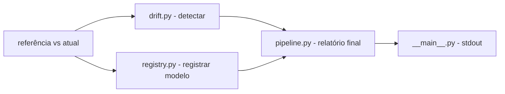

# mlops-registro-drift

[English](README.en.md) · **Português (Brasil)**

[](#) [](#) [](#) [](#) [](#) [](LICENSE)

## O que é

**Pipeline MLOps de registro de modelo e detecção de drift de dados**: registra um modelo (via **MLflow** quando instalado, senão em **JSON local**) e compara dados de **referência × atuais** para detectar **drift** (via **Evidently** quando instalado, senão com um teste estatístico próprio nas médias das colunas). Inclui **Dockerfile** para rodar a pipeline isolada. É um laboratório educacional de MLOps robusto ao ambiente (fallbacks).

## Status

Laboratório educacional de MLOps, funcional e testado (19 testes). Roda sem dependências opcionais (fallbacks embutidos).

## Funcionalidades

- **Registro de modelo** (`registry.py`): `ModelEntry`/`ModelRegistry` com versionamento; usa MLflow se disponível, senão grava em JSON local (`source: "local"/"mlflow"`).
- **Detecção de drift** (`drift.py`): `DriftDetector`/`DriftReport` — compara médias das colunas (Evidently se disponível); relata `drift_detected`, `n_drifted`, `n_columns`.
- **Pipeline** (`pipeline.py`): orquestra registro + drift end to end.
- **Dockerfile**: `python:3.12-slim`, instala `.[dev]`, roda `python -m mlops_registro_drift`.
- **Fallbacks**: dependências opcionais (MLflow/Evidently) têm caminho próprio embutido.

## Arquitetura

Pacote `mlops_registro_drift` com `registry.py` (modelo + versão), `drift.py` (detecção) e `pipeline.py` (orquestração). `__main__.py` roda com dados sintéticos e imprime o resultado.



## Stack

- Python ≥ 3.10 (stdlib base; mlflow/evidently opcionais em extras)
- Docker (python:3.12-slim)
- pytest (dev)

## Estrutura do repositório

```
mlops-registro-drift/
├── pyproject.toml · BRIEF.md · Dockerfile
├── src/mlops_registro_drift/
│   ├── registry.py     # registro/versionamento de modelo
│   ├── drift.py        # detecção de drift de dados
│   ├── pipeline.py     # orquestração
│   └── __main__.py     # CLI/demo de dados sintéticos
├── tests/              # 19 testes
└── LICENSE             # MIT
```

## Pré-requisitos e instalação

Python ≥ 3.10.

```bash
pip install -e .          # base (fallbacks)
pip install -e ".[mlflow,evidently]"   # opcional: integrações reais
```

## Como executar

```bash
python -m mlops_registro_drift
# Pipeline mlops-registro-drift executado com sucesso.
# Modelo: modelo-demo v2 (local)
# Drift detectado: False (0/2 colunas)

# via Docker
docker build -t mlops-drift . && docker run --rm mlops-drift
```

## Testes e qualidade

Comando real (verificado pelo agente):

```bash
PYTHONPATH=src python -m pytest tests/
# 19 passed
```

## Decisões técnicas e trade-offs

- **Fallbacks (MLflow/Evidently opcionais)**: a pipeline roda em qualquer ambiente; em troca, sem as integrações, usa implementações próprias.
- **Registro local em JSON** quando MLflow não está presente: versionamento simples e portátil.
- **Drift por médias de colunas**: teste estatístico leve e transparente; menos poderoso que Evidently completo.

## Limitações conhecidas e roadmap

- Sem MLflow/Evidently instalados, usa os fallbacks (funcional, mas menos robusto que as ferramentas).
- O drift detecta mudanças de distribuição básicas (médias); não cobre correlações/qualidade de dados avançada.
- Demo com dados sintéticos em `__main__`.

## Processo de desenvolvimento

Projeto individual de Kelvin Oliveira, construído com agentes de IA orquestrados e revisado pelo autor. O pipeline MLOps, os fallbacks e a revisão são do autor.

## Licença e autor

MIT — Copyright (c) 2026 Kelvin Rebelo de Oliveira.

**Autor**: [Kelvin Oliveira](https://github.com/KelvinOliveiraCode) · [Portfólio](https://kelvinoliveiracode.github.io/portfolio/)
